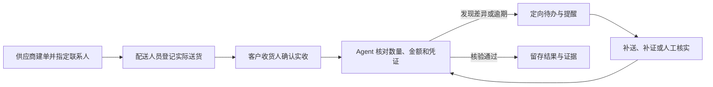
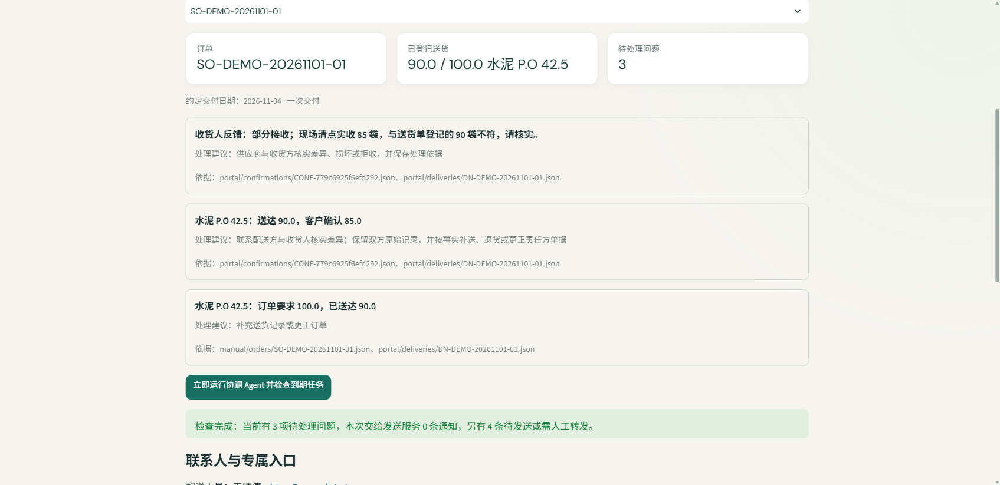

# DeliveryProof-Agent

**把订单、送货和收货确认串成可追踪的交付闭环。**

[](https://www.python.org/) [](LICENSE) [](https://github.com/Galaxy527/DeliveryProof-Agent/actions/workflows/tests.yml)

开源的建材交付协作 Agent：协调供应商、配送负责人和客户收货人，自动核对差异、生成定向待办、跟踪补证与超期提醒。无需 API Key 即可在本机跑通结构化业务流程。

> **状态：本机试用版。** 邮件和语音通知需要自行配置服务商；专属链接不能代替强身份认证或电子签名。



**核心能力**

- **三方分工与权限隔离：** 每笔订单生成配送和收货专属入口，各方只填写自己的业务记录。
- **可解释的确定性核验：** 对数量、金额、重复单据、缺签收及分批交付期限执行规则检查，保留原始依据。
- **持续跟进：** 新记录进入后自动复核；后台进程检查超期、去重提醒并取消已失效的待发通知。
- **可选 AI 与通信渠道：** 用 DeepSeek Flash 辅助提取图片/PDF 字段；SMTP 邮件和 Twilio 语音须显式开启。
- **本机开箱体验：** Streamlit、SQLite 和项目内虚拟环境；测试不依赖真实订单、API Key 或外部消息服务。

## 界面演示

下面的页面来自实际运行的三方流程，订单、姓名和邮箱均为虚构数据。供应商建立 100 袋水泥订单，配送登记 90 袋，客户反馈实收 85 袋；协调 Agent 保留双方原始记录，并列出待核实差异及依据。



查看[从建单到复核的完整截图与操作说明](docs/DEMO_WALKTHROUGH.md)。

## 项目要解决什么

面向单家建材供应商的订单交付跟进。供应商把已有订单登记到工作台，配送人员通过专属入口提交送货单，客户指定的收货人通过另一入口确认实收数量。协调 Agent 在新资料进入后复核，并由后台工作进程检查超期事项、生成定向提醒。供应商看到问题、联系人、处理记录与证据来源。

这个流程参考真实建材交付中由供货方提供发货凭证、现场验收方核对并签收的分工；具体签收人与交付期限应以实际合同为准。[天津市预拌混凝土买卖合同示例](https://scjg.tj.gov.cn/tjsscjdglwyh_52651/zxfw/htwb/202007/W020200720056032446861.pdf) · [上海市建材供应现场工作指南](https://zjw.sh.gov.cn/cmsres/bc/bccbd22a7ccb45628648ac4ad321317b/1075477259fa9e0acb134950d2da78c9.pdf)

## 三方如何使用

| 角色 | 自己提交什么 | 看不到或不能改什么 |
| --- | --- | --- |
| 供应商订单负责人 | 原始订单号、客户、商品、数量、单价、约定交付日、各方联系人；可上传原订单图片/PDF 辅助提取 | 不能替客户确认实际收货 |
| 配送负责人 | 自己订单的送货单号与本次实送数量；可按实际分多次登记 | 不能改订单价格，不能替客户签收 |
| 客户指定收货人 | 对每张送货单确认全部接收、部分接收、有损坏或拒收，填写实收数量与说明，可附图片/PDF | 不能改订单或配送记录 |

各方的入口使用不同的长随机令牌，数据库只保存令牌摘要；任务入口默认 30 天有效，供应商可重新发放并使旧入口失效。链接本身就是访问凭证，必须只发给对应人员。线上收货确认只说明持有该专属链接的人提交了记录，**不等同于独立身份认证或具有法律效力的电子签名**。

### 一笔订单如何闭环

1. 供应商登录并建立已有订单，核对上传文件的提取草稿，填写约定交付日期，指定配送与客户收货联系人。系统创建两方任务入口。
2. 配送负责人登记每次实际送货。系统按订单核对商品、数量、价格、金额及是否缺客户确认。允许分批时，在约定日期前的未送余额不会直接认定为少送；逾期后才生成少送跟进。
3. 收货人按送货单提交实收数量。部分接收、损坏和拒收都会留下未解决的问题；系统不会把“已反馈”误认为“已核对完成”。
4. 协调 Agent 在每次提交后重新核对。送货满 24 小时仍缺收货确认时提醒收货人；逾期未送足时提醒配送方；客户反馈差异时分别提醒配送方或供应商负责人。相同问题不会重复生成提醒；问题解决后取消未发出的旧提醒。
5. 后台工作进程每 5 分钟检查一次，实际每笔订单最多每小时重查一次。未解决提醒超过 72 小时后，可通过已配置的语音渠道升级。处理日志、通知状态和核验结果保存在本地 SQLite。

确定的数量与金额由规则程序计算；文件字段提取可调用 DeepSeek Flash，提取结果必须由供应商确认。协调 Agent 的提醒路由是可审计的规则流程，避免模型自行决定签名真伪、价格或责任归属。

## 本机运行

Python 3.11/3.12，所有依赖安装在项目内虚拟环境：

```powershell
python -m venv .venv
.\.venv\Scripts\python.exe -m pip install -r requirements.txt
.\.venv\Scripts\python.exe -m streamlit run app\ui\streamlit_app.py --server.port 8501
```

浏览器打开 [http://127.0.0.1:8501](http://127.0.0.1:8501)。本机第一次使用时，点击页面上的「显示本机初始口令」，保存口令后登录。程序默认只监听 `127.0.0.1`；配送和收货入口中的本机链接仅用于本机流程验证。真实多设备协作需要 HTTPS 部署、可访问的域名以及服务器管理员口令。

要让到期检查在无人打开网页时继续运行，请在第二个终端启动：

```powershell
.\.venv\Scripts\python.exe -m app.worker
```

也可用 `-m app.worker --once` 手动执行一次。新协作数据默认写入 `deliveryproof-collaboration.sqlite3`。旧版本的 `deliveryproof-user.sqlite3` 和 `deliveryproof-workspace.sqlite3` 仍保留，新入口不会自动导入它们；可用 `DELIVERYPROOF_DB` 指定数据库。

## 邮件、电话与外部文件识别

不开启任何外部渠道时，系统只在「Agent 提醒记录」中保存待发通知，且允许供应商复制专属入口自行发送。要自动发送邮件，需要配置 `.env` 或进程环境变量中的 `DELIVERYPROOF_PUBLIC_URL=https://...`、SMTP 地址与账号，并将 `DELIVERYPROOF_AUTO_EMAIL=1`。发送时邮件会附上对应角色的专属任务链接。服务商接受邮件请求会记为已发送，实际送达仍需结合邮件服务反馈。

自动语音升级默认关闭。配置 Twilio 账号、发信号码并设置 `DELIVERYPROOF_AUTO_CALL=1` 后，未解决任务超过 72 小时才会尝试语音通知；电话只播报通用提醒，不读取订单细节。[Twilio 外呼 API](https://www.twilio.com/docs/voice/api/call-resource)。不同地区号码与服务可用性需按所选通信商核实，项目没有附带账号或费用。联系人信息的使用目的、方式与保存期限应向相关人员说明，参见[《个人信息保护法》](https://www.samr.gov.cn/wljys/gzzd/art/2023/art_3ef1e889c1e644d4b65b5f5c7f432386.html)。

订单图片/PDF 提取使用 DeepSeek Flash，设置 `DEEPSEEK_API_KEY` 后才会发送文件内容给该服务；手工建单、结构化核对、三方权限与提醒队列不需要模型密钥。`.env`、口令文件、上传附件和 SQLite 数据均被 `.gitignore` 排除。不要把真实联系方式或签收材料提交到代码仓库。

## 验证

```powershell
.\.venv\Scripts\python.exe -m pytest -q --basetemp .tmp\pytest-readme
.\.venv\Scripts\python.exe tests\manual_collaboration_ui.py
```

第二条在隔离数据库中完成供应商建单、配送登记、收货确认与自动复核。测试使用虚构联系人，不调用外部模型、邮件或电话。`tests/test_collaboration.py` 还覆盖角色越权、分批到期、提醒去重与取消、拒收保留问题、专属入口轮换和模拟邮件链接隔离。

旧版单人录入页保存在 `app/ui/legacy_app.py`，旧的命令行及合成样例仍供规则测试使用；日常入口是 `app/ui/streamlit_app.py`。

## 当前边界

- 协作页面目前一次处理一个商品；未连接供应商 ERP、仓库系统或客户身份系统。
- 专属链接是角色范围内的访问控制，不是强身份认证。公网部署前需要增加企业登录、租户隔离、HTTPS 反向代理和更完整的安全审查。当前默认仅供本机或受控内网评估。
- 客户提交拒收、货损或数量差异后，系统保留问题和记录，需要供应商与对方线下核实并形成补送、更正或赔付依据；当前页面尚无完整的争议结案审批。
- 邮件与电话接口已接入可选服务商，但项目没有通信账号，未做真实外呼验收。默认不会向任何真实联系人发送消息或打电话。
