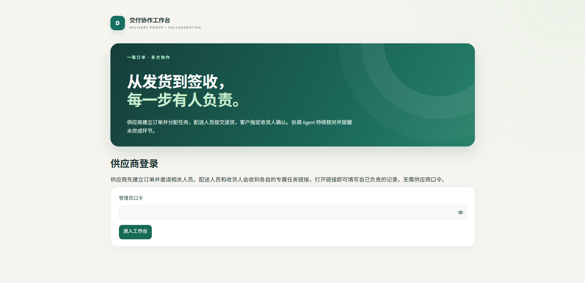
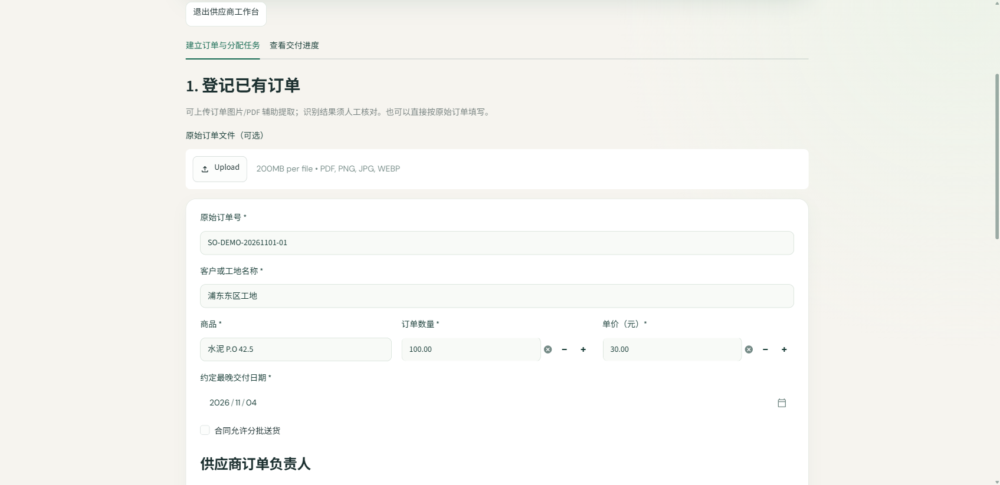
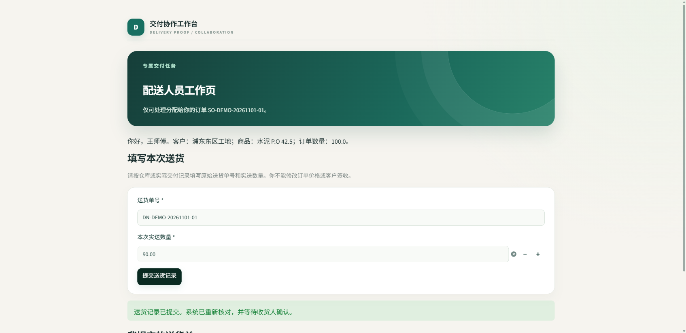
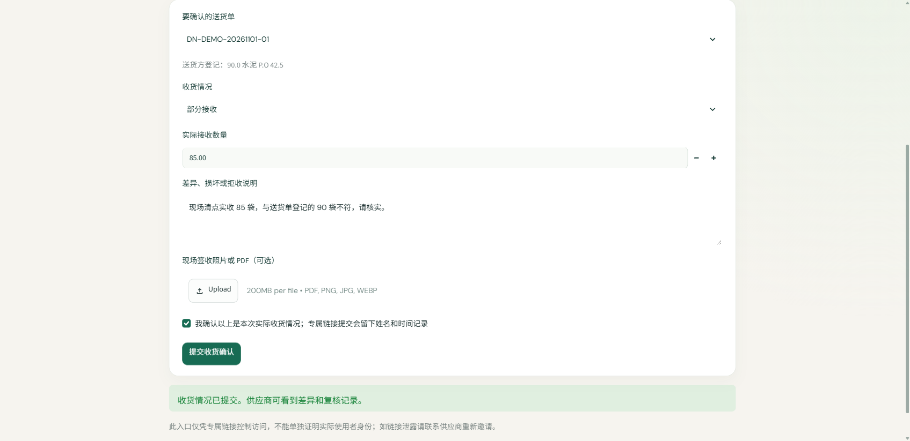
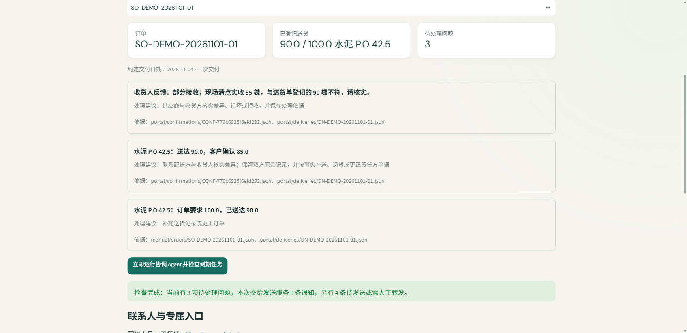

# 三方交付演示

以下截图取自实际运行的本机网页。演示订单 `SO-DEMO-20261101-01` 要求水泥 100 袋、单价 ¥30，约定一次交付。客户与联系人均为虚构数据；演示未调用外部邮件、电话或模型服务。

截图拍摄后，配送页增加了原始送货单金额及附件输入，供应商页增加了签收凭证审核和差异处理入口；截图中的旧表单字段以当前运行页面为准。

## 1. 供应商进入工作台

供应商登录后建立已有订单，并指定配送负责人和客户收货人。系统为两方分别生成专属任务入口。

## 2. 配送人员登记实际送货

配送人员在自己的入口提交送货单 `DN-DEMO-20261101-01`，登记实送 90 袋。此入口不能修改订单价格或替客户确认收货。

## 3. 客户收货人确认差异

收货人查看该送货单，选择“部分接收”，填写实收 85 袋及现场说明。此入口不能改写配送人员提交的 90 袋记录。

## 4. 协调 Agent 复核与跟进

供应商再次打开交付进度并运行协调 Agent。页面显示三项待处理问题：部分接收、送货与实收相差 5 袋、订单与送货相差 10 袋。每项问题都列出处理建议和原始单据依据；提醒未配置发送渠道时保留为待发，不会声称已经通知到相关人员。

该演示展示问题发现和跟进状态。真实业务中，差异需由相关人员核实并提交补送、退货或更正依据后才能结案。
